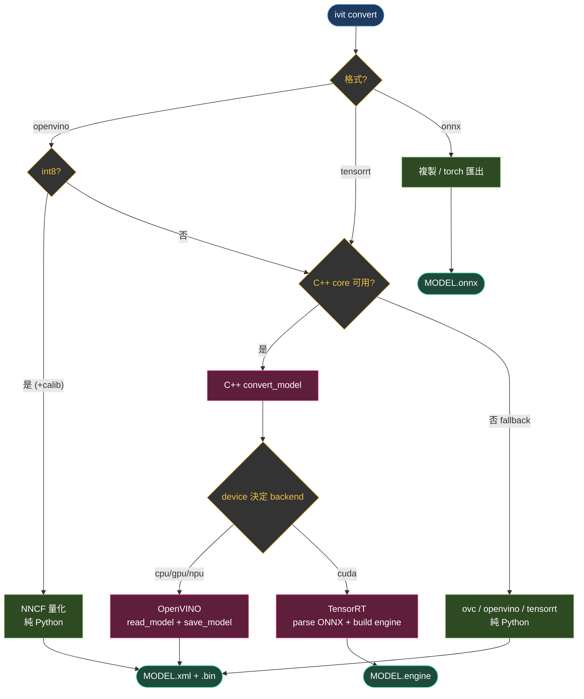
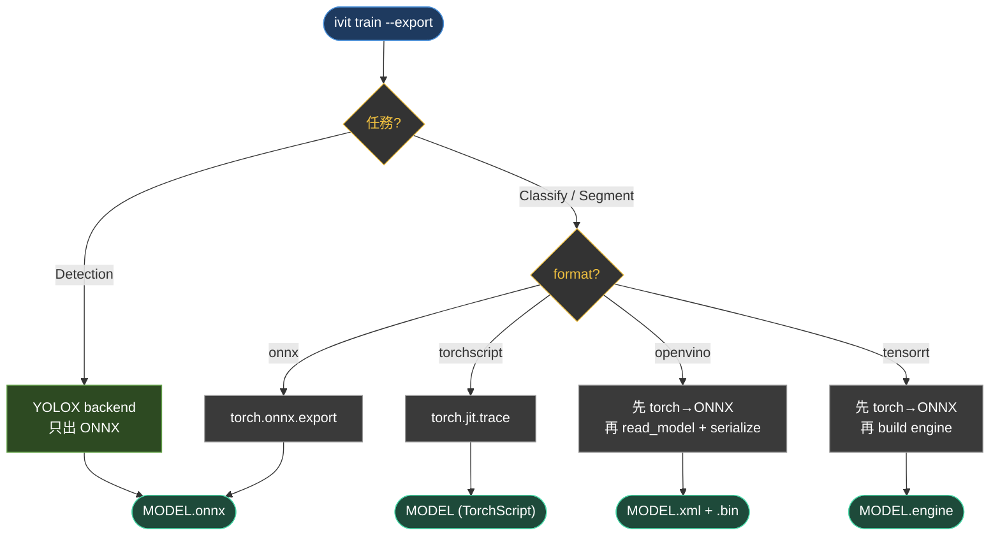

# iVIT-SDK 模型轉檔／匯出流程圖

- **Convert（轉檔）**：檔案轉檔案（ONNX / IR → 目標格式），C++ core 優先，Python fallback。
- **Export（匯出）**：訓練好的 PyTorch `nn.Module` → 各格式，純 Python，一定先過 ONNX 中間檔。

---

## 一、Convert 流程（檔案轉檔案）

---

## 二、Export 流程（PyTorch nn.Module 匯出）

---

## 三、關鍵差異

| 面向 | Convert | Export |
|------|---------|--------|
| 源頭 | 檔案（ONNX / IR） | PyTorch `nn.Module` |
| 執行位置 | C++ core 優先，Python fallback | 純 Python |
| 中間 ONNX | 不需要 | 一定先產生 |
| INT8 真校正 | 僅 OpenVINO（NNCF） | 僅 OpenVINO（NNCF） |
