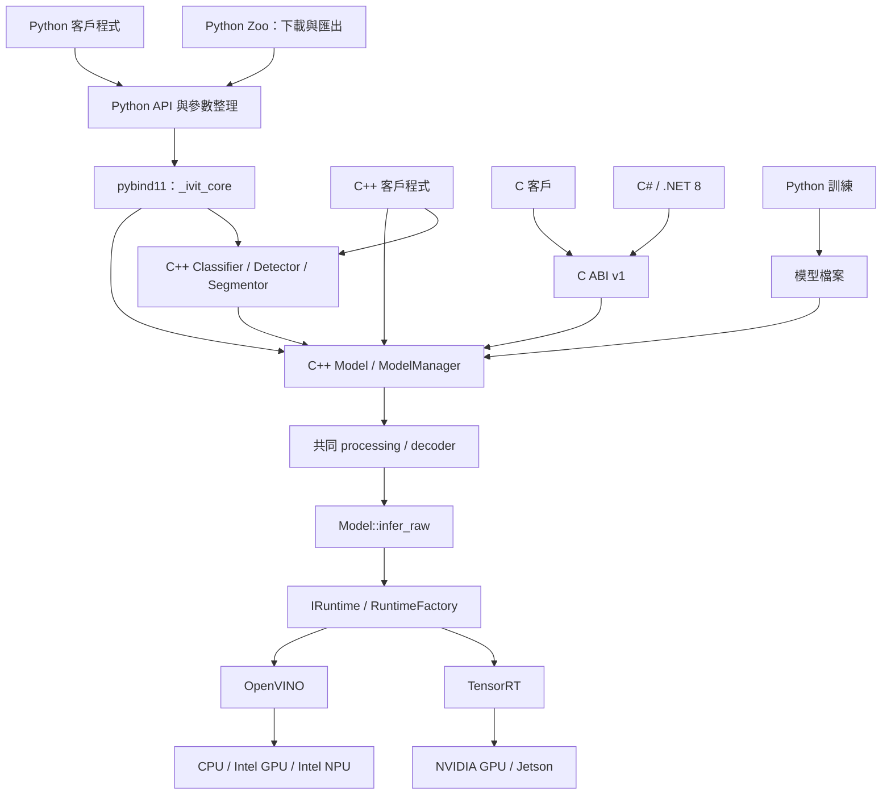
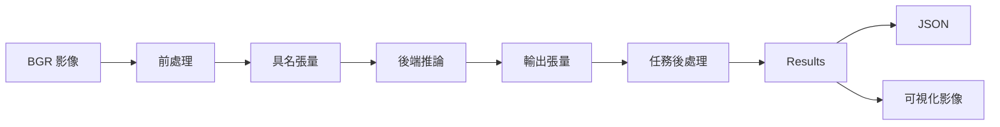
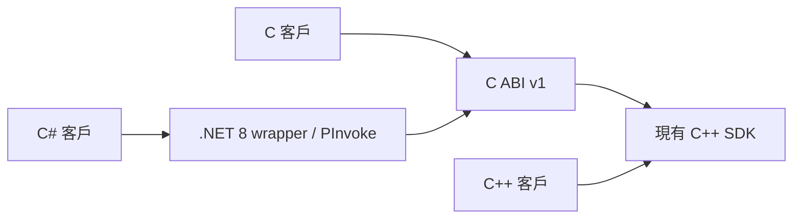

# iVIT-SDK 使用手冊

版本：repository 宣告的 1.1.0（變更見 [CHANGELOG](../CHANGELOG.md)）。更新日期：2026-10-08。

本手冊依目前 C++ 標頭、Python bindings 與實作整理，涵蓋安裝、架構、主要公開 API、推論與整合範例。API 存在不代表所有模型或平台已驗證；下列範例需要相容模型、驅動及後端。OpenVINO／TensorRT 的已驗證範圍見 [CHANGELOG](../CHANGELOG.md) 與兩份設備驗證紀錄（[OpenVINO](development/openvino-device-verification.zh-TW.md)、[TensorRT](development/tensorrt-device-verification.zh-TW.md)）；未逐一實測所有手冊範例。

## 目錄

1. [功能與整合選擇](#1-功能與整合選擇)
2. [架構與資料流](#2-架構與資料流)
3. [安裝與建置](#3-安裝與建置)
4. [模型與輸入契約](#4-模型與輸入契約)
5. [API 清單](#5-api-清單)
6. [Python 範例](#6-python-範例)
7. [C++ 範例](#7-c-範例)
8. [C／C# 整合](#8-cc-整合)
9. [部署、驗證與疑難排解](#9-部署驗證與疑難排解)
10. [目前限制與原始碼索引](#10-目前限制與原始碼索引)

## 1. 功能與整合選擇

SDK 提供分類、物件偵測及語意分割的主要 C++ 推論流程，Python 透過 pybind11 呼叫核心，另提供訓練、模型下載與工具模組。

| 客戶需求 | 使用方式 | 目前狀態 |
|---|---|---|
| Python 推論 | `ivit.load()` 或 `ivit.vision` | 需要已建置的 `_ivit_core` |
| C++ 推論 | `ivit::load_model()` 或 `ivit::vision` | 原生 C++ API |
| C 整合 | `include/ivit/c_api.h` | 同步單張與批次推論（BGR 或灰階）、模型資訊、JSON／mask、日誌 callback、錯誤類別與明確釋放 |
| C# 本機整合 | `bindings/csharp/IvitSdk` | .NET 8、64-bit、P/Invoke／SafeHandle |
| 跨語言／遠端整合 | 自行封裝服務 | SDK 未提供 REST server；應用需管理請求與模型生命週期 |
| 訓練、Zoo、模型匯出 | Python 模組 | 各模型需對應套件；不是完整 C++ 功能 |

### 1.1 裝置與後端

| 裝置代號 | 後端 | 硬體方向 | 注意事項 |
|---|---|---|---|
| `cpu` | OpenVINO | Intel CPU；可評估受支援 ARM CPU | 需對應平台 runtime，ARM 另驗證建置 |
| `gpu:0` | OpenVINO | 受支援 Intel GPU | 不是 NVIDIA GPU 的代號 |
| `npu` | OpenVINO | 受支援 Intel NPU | 需驅動及模型算子相容 |
| `cuda:0` | TensorRT | NVIDIA GPU、Jetson | 需相容 CUDA／TensorRT／JetPack |
| `auto` | 自動選擇 | 依已註冊後端與裝置 | 是優先順序策略，不是實測最佳效能 |

可用硬體取決於後端版本、驅動與模型。此表不代表 SDK 已完成所有平台驗證；目前原始碼含 Linux 專用 API，Windows 相容性需額外處理。

## 2. 架構與資料流

### 2.1 模組架構圖



`core` 管理模型、裝置、張量、結果與非同步介面；`runtime` 封裝後端；`vision` 提供任務專用前後處理；`utils` 提供可視化（Visualizer）；profiling 由 Python 的 `ivit.utils.Profiler` 與 OpenVINO 的 `LoadConfig.enable_profiling` 提供。

### 2.2 推論資料流



通用 `Model.predict()`、vision 類別與 C／C# 影像入口使用 `src/vision/processing.cpp` 的同一份前後處理。`infer_raw()` 則由呼叫端提供具名張量並處理輸出。

### 2.3 原始碼結構

| 路徑 | 用途 |
|---|---|
| `include/ivit/` | C++ 公開 API |
| `src/core/`、`src/runtime/`、`src/vision/` | 核心、後端與任務實作 |
| `python/ivit/_binding.cpp` | 實際 Python bindings |
| `python/ivit/` | Python 外層、Zoo、訓練與工具 |
| `examples/cpp/`、`examples/python/` | 範例程式 |
| `tests/cpp/`、`tests/python/`、`tests/integration/` | 測試 |
| `scripts/` | 建置與部署工具 |
| `packaging/` | 二進位套件安裝說明 |

## 3. 安裝與建置

### 3.0 自動安裝腳本（Ubuntu／Debian）

建議從 repository 根目錄使用安裝腳本：

```bash
# 只檢查依賴，不安裝任何套件。
bash scripts/install_sdk.sh --check
# 安裝系統依賴、建立 .venv、安裝 OpenVINO 與 Python SDK。
bash scripts/install_sdk.sh
# 包含 pytest 等開發工具。
bash scripts/install_sdk.sh --dev
# 純 C++ 建置；venv 僅提供 CMake／OpenVINO 建置工具。
bash scripts/install_sdk.sh --mode cpp
# 另外編入 TensorRT 後端（需先依 3.4 安裝 NVIDIA 驅動與 CUDA／TensorRT 開發套件）。
bash scripts/install_sdk.sh --tensorrt
```

腳本預設透過 `sudo apt-get` 安裝 `build-essential`、`python3`、`python3-venv`、`libopencv-dev`、`pkg-config`（Python 模式另加 `python3-dev`，`--mode cpp --dev` 另加 `libgtest-dev`）；套件下載需網路，sudo 可能要求密碼。Python 套件全部使用專案 `.venv`，不使用系統 pip。

若 native 系統套件已由管理員安裝：

```bash
bash scripts/install_sdk.sh --skip-system --venv /tmp/ivit-venv --jobs 2
```

**安裝到哪個 Python 環境**：已啟用虛擬環境時（`$VIRTUAL_ENV`）裝進該環境；沒有啟用時建立並使用 repository 的 `.venv`；`--venv PATH` 明確指定且優先。腳本一開始與結束時都會印出實際使用的環境，並在終端機啟用的是另一個環境時提醒。既有 venv 可重用，不會覆寫其他類型目錄。`--jobs` 控制編譯平行度，預設 2。純 C++ 的 `--dev` 會安裝 GoogleTest 並執行 CTest。純 C++ 模式的建置輸出在 `build/install-openvino/`；Python 模式以 `pip install -e` 安裝到 venv。

腳本預設只安裝 OpenVINO 版本；`--tensorrt` 會另外編入 TensorRT，但不自動安裝 NVIDIA 驅動、CUDA／TensorRT 開發套件或 GPU／NPU 驅動（缺少時在建置前報錯並指向 3.4）。Python 模式最後驗證 bindings 和可用裝置；模型推論與準確度仍需客戶模型測試。依賴沒有完全鎖版，重跑可能使用較新的相容套件。

### 3.1 前置條件與指令檢查

以下命令適用 Linux／Bash，Ubuntu 24.04 的系統 Python 指令使用 `python3`；不要假設有 `python`。本手冊 Python 命令統一使用 `python3`。

- C++17 編譯器、CMake 3.18+、OpenCV C++ 開發套件。
- Python 路線需 Python 3.10+（OpenVINO 2026 不提供 3.9 套件；3.10 與 3.12 已跑過完整測試）、venv；pyproject 使用 scikit-build-core 與 pybind11 建置。
- OpenVINO 或 CUDA／TensorRT 的開發套件與相容驅動。
- C++ 測試需 GoogleTest。Python wheel `opencv-python` 不提供此專案需要的 C++ headers 與 `OpenCVConfig.cmake`。

Ubuntu／Debian 系統依賴安裝方式（需管理員權限；venv 不會安裝這些系統套件）：

```bash
sudo apt-get update
sudo apt-get install build-essential cmake python3-venv python3-dev libopencv-dev pkg-config
# 若要執行 C++ 測試（含 3.5 的 CI 腳本），另外安裝 libgtest-dev。
```

先確認系統工具：

```bash
python3 --version
c++ --version
pkg-config --modversion opencv4
```

### 3.2 Python 原始碼安裝（venv）

於 repository 根目錄執行。若已有 `.venv`，先確認它屬於此專案，再使用或另選目錄。

```bash
python3 -m venv .venv
source .venv/bin/activate
python3 -c "import sys; print(sys.executable); assert sys.prefix != sys.base_prefix"
python3 -m pip --version
python3 -m pip install cmake 'openvino>=2026.0'
cmake --version
```

這裡的 CMake 與 OpenVINO 安裝在 venv；先安裝 OpenVINO，讓 native configure 能找到其 CMake 設定。**pip 版 OpenVINO 必須是 2026 以上**：2024、2025 的 pip 套件以舊版 C++ ABI（`_GLIBCXX_USE_CXX11_ABI=0`）編譯，與系統 OpenCV 連結時會出現 `undefined reference to cv::imread(std::string const&, int)` 之類的錯誤（已實測 2025.4.1 失敗、2026.4.1 成功）。Intel apt 套件與官方 tgz 封存檔使用系統工具鏈的新 ABI，2024.6、2025.4.1 與 2026.4.1 皆已驗證可用（release 使用 apt 版 2026.4.1）。OpenVINO 函式庫的 SONAME 帶版本號（例如 `libopenvino.so.2641`），執行時必須使用建置時的同一版本。系統沒有 pip 並不影響已成功建立且含 pip 的 venv。若建立 venv 時缺少 ensurepip，先安裝 `python3-venv`；不要改用系統 pip 安裝 SDK。

確認 native OpenCV 開發套件可用後，只啟用 OpenVINO 建置：

```bash
python3 -m pip install -e '.[dev,openvino]' \
  -Ccmake.define.IVIT_USE_OPENVINO=ON \
  -Ccmake.define.IVIT_USE_TENSORRT=OFF
python3 -c "import ivit; print(ivit.__version__); assert ivit.is_cpp_available(), ivit.get_runtime_info(); print(ivit.list_devices())"
```

`import ivit` 成功不代表 bindings 成功；上面的 assertion 必須通過。`.[dev]` 包含 pytest、onnx（測試用來產生小模型；缺少時約 20 個測試檔會被跳過）與開發工具，只需推論可改用 `.[openvino]`。訓練相關測試另需 torch（`.[train]`），C ABI 測試需設定 `IVIT_C_LIBRARY`（見 9.2）。`.[zoo]`、`.[train]` 是選用功能，仍需依模型安裝匯出依賴。

若使用自訂 OpenCV 安裝位置，可在 pip 命令加上 `-Ccmake.define.OpenCV_DIR=/absolute/path/to/opencv/cmake`。該目錄必須實際包含 `OpenCVConfig.cmake`。

關閉終端或執行 `deactivate` 後，再次使用 SDK 前需重新執行 `source .venv/bin/activate`。

### 啟用 TensorRT 的 Python 安裝

先依 3.4 安裝 NVIDIA 驅動與 CUDA／TensorRT 開發套件，再用安裝腳本（建立 `.venv`、建置、驗證一次完成）：

```bash
bash scripts/install_sdk.sh --tensorrt          # 缺少 CUDA／TensorRT 時會在建置前報錯並指向 3.4
```

或手動執行與上面相同的 pip 命令，把 TensorRT 改為 ON，並加上 `IVIT_REQUIRE_BACKENDS`：

```bash
python3 -m pip install -e '.[dev,openvino]' \
  -Ccmake.define.IVIT_USE_OPENVINO=ON \
  -Ccmake.define.IVIT_USE_TENSORRT=ON \
  -Ccmake.define.IVIT_REQUIRE_BACKENDS=ON
python3 -c "import ivit; print(ivit.list_devices())"      # 應出現 cuda:0（tensorrt）
```

沒有 `IVIT_REQUIRE_BACKENDS=ON` 時，找不到 TensorRT 或 CUDA 只會讓 CMake 發出警告並建出沒有 TensorRT 的版本，而 pip 預設不顯示這個警告；因此要求 TensorRT 時務必加上。TensorRT／CUDA 不在系統路徑時，加 `-Ccmake.define.TENSORRT_ROOT=...`、`-Ccmake.define.CUDAToolkit_ROOT=...`（`install_sdk.sh` 會讀取同名環境變數）。裝置列表只在有可用的 NVIDIA GPU 與驅動時才會出現 `cuda:0`，可先用 `nvidia-smi` 確認。已實測：25 秒完成，yolox-s FP16 在 RTX 2070 SUPER 約 4.3 ms，完整 Python 測試通過（261 項，跳過的只有 C ABI、torch、NPU 相關）。

不想安裝系統套件時，可改用 3.5 的 `--tensorrt`（CUDA／TensorRT 函式庫取自 pip，產物留在建置目錄）。

### 3.3 純 C++：OpenVINO 版本

先完成 3.1 的 native 系統依賴。可以沿用 3.2 的 venv 提供 CMake 與 OpenVINO，但關閉 Python bindings 後，應用程式的推論不需 Python。以下使用獨立的 `build-openvino` 目錄，避免沿用其他後端的 CMake cache。

```bash
cmake -S . -B build-openvino \
  -DCMAKE_BUILD_TYPE=Release \
  -DIVIT_BUILD_PYTHON=OFF \
  -DIVIT_BUILD_TESTS=OFF \
  -DIVIT_BUILD_EXAMPLES=ON \
  -DIVIT_USE_OPENVINO=ON \
  -DIVIT_USE_TENSORRT=OFF
cmake --build build-openvino -j
./build-openvino/bin/simple_inference devices
```

若 CMake 無法找到 OpenVINO，將 `OpenVINO_DIR` 指向 runtime 的 CMake 設定目錄；TensorRT 則以 `TENSORRT_ROOT` 指向其安裝目錄。

### 3.4 純 C++：TensorRT 版本

先安裝 NVIDIA 驅動（需支援 CUDA 12.9），以及 CUDA／TensorRT 的 native 開發套件。`pip install openvino` 不會安裝這些 NVIDIA 依賴。Ubuntu 24.04 使用 NVIDIA 的 apt 來源（其他版本請把 `ubuntu2404` 換成對應名稱）：

```bash
wget https://developer.download.nvidia.com/compute/cuda/repos/ubuntu2404/x86_64/cuda-keyring_1.1-1_all.deb
sudo dpkg -i cuda-keyring_1.1-1_all.deb
sudo apt-get update
sudo apt-get install -y --no-install-recommends \
  cuda-nvcc-12-9 cuda-cudart-dev-12-9 \
  libnvinfer11=11.4.0.106-1+cuda12.9 libnvinfer-dev=11.4.0.106-1+cuda12.9 \
  libnvinfer-headers-dev=11.4.0.106-1+cuda12.9 libnvinfer-safe-headers-dev=11.4.0.106-1+cuda12.9 \
  libnvonnxparsers11=11.4.0.106-1+cuda12.9 libnvonnxparsers-dev=11.4.0.106-1+cuda12.9
```

版本必須全部指定：不指定時 apt 會選到來源中最新的 CUDA 13／其他 TensorRT 版本，`libnvinfer` 的 soname 也會不同；漏掉 `libnvinfer-safe-headers-dev` 會出現 `unmet dependencies`（`libnvinfer-dev` 要求同一版）。下載約 1.5 GB、安裝後約 4 GB。安裝後 `nvcc`、`NvInfer.h` 與函式庫都在系統路徑（`/usr/local/cuda`、`/usr/include/x86_64-linux-gnu`、`/usr/lib/x86_64-linux-gnu`），建置與執行都不必設定環境變數；裝在其他位置時指定 `-DTENSORRT_ROOT=/path/to/tensorrt`、`-DCUDAToolkit_ROOT=/path/to/cuda`。

接著把 3.3 的設定改為 `IVIT_USE_OPENVINO=OFF`、`IVIT_USE_TENSORRT=ON`，建置目錄改為 `build-tensorrt`，並加上 `-DIVIT_REQUIRE_BACKENDS=ON`（找不到 TensorRT／CUDA 時直接失敗，而不是建出沒有 TensorRT 的版本）：

```bash
cmake -S . -B build-tensorrt -DCMAKE_BUILD_TYPE=Release \
  -DIVIT_BUILD_PYTHON=OFF -DIVIT_BUILD_TESTS=OFF -DIVIT_BUILD_EXAMPLES=ON \
  -DIVIT_USE_OPENVINO=OFF -DIVIT_USE_TENSORRT=ON -DIVIT_REQUIRE_BACKENDS=ON
cmake --build build-tensorrt -j
./build-tensorrt/bin/simple_inference devices        # 應列出 cuda:0（tensorrt）
```

已在 Ubuntu 24.04、上述套件與 RTX 2070 SUPER 驗證：6 秒建完、無警告，`detection_demo` 以 `cuda:0` 推論 Zoo 的 yolox-s 與 CPU 結果一致。

**必須檢查 CMake Summary**：找不到後端時，建置可能停用該後端，成功編譯不代表具備可用推論引擎。TensorRT API 相容性需實際編譯確認，不能只依 Python metadata 的最低版本判斷。

### 3.5 從零建置與測試（與 CI 相同）

`scripts/ci/build_and_test.sh` 會建立獨立 venv、建置 SDK（含範例與 C++ 測試）、執行 CTest 與完整 Python 測試，最後移除建置放進原始碼樹的 `_ivit_core*.so` 與 `__pycache__`。venv、build 與 stage 預設保留在 `build-ci/`，可用 `--work DIR` 改放到原始碼樹外。`ci.yml` 的原生建置工作（build-openvino、build-tensorrt、gpu）都執行這支腳本，因此本機可重現這些工作；`fast-checks` 工作（flake8、shell 語法檢查、metadata 測試）不在腳本內，需另外執行：

```bash
bash scripts/ci/build_and_test.sh              # OpenVINO 版
bash scripts/ci/build_and_test.sh --tensorrt   # OpenVINO + TensorRT 版
```

腳本結束時會印出使用這份建置結果的指令。要在自己的程式使用，需設定兩個環境變數（此時 `LD_LIBRARY_PATH` 必須包含 pip 版 OpenVINO／TensorRT／CUDA runtime 的函式庫目錄，否則會出現 `libnvinfer.so.11: cannot open shared object file`）：

```bash
export LD_LIBRARY_PATH="$PWD/build-ci/build/lib:$PWD/build-ci/venv/lib/python3.12/site-packages/openvino/libs:$PWD/build-ci/venv/lib/python3.12/site-packages/tensorrt_libs:$PWD/build-ci/venv/lib/python3.12/site-packages/nvidia/cuda_runtime/lib"
export PYTHONPATH="$PWD/build-ci/stage"
build-ci/venv/bin/python -c 'import ivit; print(ivit.list_devices())'   # 應列出 cuda:0
```

C++ 範例在 `build-ci/build/bin/`（同一組 `LD_LIBRARY_PATH`）。用 `--work DIR` 時請把 `build-ci` 換成該目錄；Python 版本不是 3.12 時請調整路徑。

`--tensorrt` 不需要預先安裝 CUDA toolkit：TensorRT 與 CUDA runtime 函式庫取自 pip，TensorRT 標頭取自 NVIDIA 開源版本（與 pip 套件同一版 11.4）。沒有 GPU 時仍會編譯並連結 TensorRT 後端，只跳過需要 GPU 的測試。腳本需要 3.1 列出的系統套件（含 `cmake` 3.18 以上與 `libgtest-dev`）；`--tensorrt` 另需 `curl` 與網路，以下載 TensorRT 標頭。

### 3.6 指定 GPU／NPU 驗證

安裝對應驅動並確認裝置權限後，可執行 `python3 scripts/verify_openvino.py --device gpu:0` 或 `--device npu`。工具需要 NumPy、ONNX、OpenVINO 與已建置 bindings；GPU 可加 `--dynamic-batch` 驗證動態 batch。此測試的動態維度沒有上限，NPU 不支援，腳本會拒絕該組合。SDK 也會在 NPU 編譯前拒絕無上限輸入；使用靜態模型，bounded dynamic shape 另需核對平台／編譯器能力。缺少裝置或推論錯誤會以非零 exit code 結束。

已在 Intel UHD Graphics 770 通過靜態／動態 batch 分類驗證，並在遠端 Core Ultra 7 255U 的 Intel GPU／AI Boost NPU 通過靜態分類驗證與 bindings 回歸測試。驗證範圍與限制見 [GPU／NPU 驗證紀錄](development/openvino-device-verification.zh-TW.md)。

### 3.7 指定 TensorRT 驗證

建置 TensorRT／OpenVINO 雙後端後，執行 `python3 scripts/verify_tensorrt.py --precision fp32`，可加 `--precision fp16`、`--dynamic-batch` 或 `--report PATH`。工具需要已建置 bindings、ONNX 與 OpenVINO CPU 參考，不會將後端缺席算作通過。RTX 2070 SUPER 上，TensorRT 10.12 已通過四組靜態／動態分類、併發、engine 往返與退出測試；TensorRT 11.4 以 `--precision fp32`、`--precision fp16`、`--precision fp16 --dynamic-batch` 重新驗證皆通過。TensorRT 11.4 的 FP16 與 FP32 比較（Zoo 全部 11 個 ready 模型、bus.jpg）：6 個分類模型 top-1 皆相同（分數差 ≤0.0023）；2 個 DeepLabV3 遮罩 ≥99.97% 一致；5 個 YOLOX 偵測數相同、框 IoU ≥0.989；FP16 每張快 1.2–3.1 倍（例：yolox-s 10.89 → 3.99 ms、deeplabv3-resnet50 52.07 → 16.78 ms）。相依套件路徑與驗證限制見 [TensorRT 驗證紀錄](development/tensorrt-device-verification.zh-TW.md)。安裝腳本預設只安裝 OpenVINO 版；`--tensorrt` 可編入 TensorRT，但不自動安裝 CUDA／TensorRT 套件。

## 4. 模型與輸入契約

### 4.1 模型檔案

- OpenVINO：ONNX 或 IR `.xml`＋配套 `.bin`。
- TensorRT：ONNX 可編譯成 engine；也可載入 `.engine`／`.trt`／`.plan`。
- C++ 範例一律使用本機模型檔；標頭註解中的 Zoo 名稱不代表 C++ 已實作自動下載。
- Python Zoo 要用 `ivit.zoo.download()`／`ivit.zoo.load()` 明確處理。登錄名稱不等於 decoder 已支援該模型。

### 4.2 影像契約

Python 通常傳入 OpenCV 讀取的 `uint8`、HWC、BGR NumPy 陣列；C++ 使用 BGR `cv::Mat`。也可以使用影像路徑。建議傳入原始 0–255 影像，避免先正規化後被 SDK 再除以 255。

通用 Model 與 vision 類別共用前後處理。影像入口為 uint8 BGR；預設轉 RGB、NCHW、pixel/255、mean=0、std=1。以 LoadConfig 的 `input_color`、`input_layout`、`input_scale`、`mean`、`std` 調整，公式為 `(pixel * input_scale - mean) / std`。偵測預設 centered letterbox，其餘預設 stretch；另可選 `letterbox_top_left`。

分類 decoder 可指定 `logits`（softmax）或 `probabilities`（不再 softmax）。偵測使用 `yolov5`、`yolov8`、`yolox`（strides 8/16/32 raw grid）、`yolox_decoded` 或 `legacy`（YOLOv5 版面、座標為 0–1 正規化值）；`raw` 表示不解碼，Results 為空。不要依模型檔名選擇 decoder。多個輸出須指定 `output_name`；整數／多輸入、自訂輸出或固定 batch>1 的模型使用 C++ `Model::infer_raw()`（Python 沒有原始輸出 API）。分類支援 [C]/[1,C]；分割支援 [1,C,H,W] logits。

labels 優先順序為明確 `labels`、`labels_path`、`model.labels.txt`、目錄 `labels.txt`；無 labels 使用 `class_ID`，有 labels 時必須符合類別數。先前 Classifier 的隱含 ImageNet 正規化已移除；ImageNet 模型請設定 mean=[0.485,0.456,0.406]、std=[0.229,0.224,0.225]。

`Detector` 與通用 `Model` 共用同一份前後處理，不會依檔名判斷模型類型；decoder 為 `auto` 時只依輸出維度推斷 YOLOv5／v8，無法判斷時報錯並要求明確指定。YOLOX 的 `[1,8400,85]` 輸出與 YOLOv5 維度相同，`auto` 會當成 YOLOv5 而不報錯，因此 YOLOX 一律明確指定 `yolox`／`yolox_decoded`（Zoo 的 `load_options` 已包含）。仍請核對實際輸出格式，並以已知影像與原模型結果做準確度驗證。

## 5. API 清單

本節列出主要應用 API；完整簽章以文末標頭及 bindings 為準。Python 的屬性通常對應 C++ 同名 getter，例如 `model.device` 對應 `model->device()`。

### 5.1 入口與裝置

| Python | C++ | 用途／差異 |
|---|---|---|
| `ivit.load(source, device="auto", task=None, **kwargs)` | `ivit::load_model(path, LoadConfig)` | Python 便利入口整理 task 別名及裝置 |
| `ivit.load_model(path, config)` | `ivit::load_model(path, config)` | 直接使用載入設定 |
| `ivit.list_devices()` | `ivit::list_devices()` | 列出 C++ 裝置資訊 |
| `ivit.get_best_device(priority="performance")` | 同名函式 | 優先順序選擇裝置 |
| `ivit.devices()`、`.best()`、`.cpu()`、`.cuda()`、`.gpu()`、`.npu()` | — | Python 便利裝置管理器；不是相同簽章 |
| `ivit.is_cpp_available()`、`ivit.get_runtime_info()` | — | Python bindings 載入診斷 |
| `ivit.__version__` | `ivit::version()` | SDK 版本 |
| `ivit.set_log_level(level)` | 同名函式 | 設定日誌等級（`debug`／`info`／`warning`／`error`／`off`） |
| `ivit.set_log_callback(fn)` | `ivit::set_log_callback(LogCallback)` | 將 SDK 日誌導入應用程式自己的日誌；`None`／空函式恢復 stderr。預設一律輸出到 stderr，不使用 stdout。callback 可能在任何 SDK 執行緒被呼叫，須為執行緒安全 |
| `ivit.set_cache_dir(path)` | 同名函式 | 設定 TensorRT engine 快取目錄（見 `use_cache`） |
| `ivit.clear_cache(cache_dir="")` | 同名函式 | 釋放記憶體模型快取；非空目錄會清理磁碟，確認範圍再使用 |
| `ivit.convert_model(src_path, dst_path, device="auto", precision="fp16")` | 同名函式 | 模型轉換；依後端能力，需驗證目標裝置 |

### 5.2 LoadConfig

| 欄位 | 預設 | 說明 |
|---|---|---|
| `device` | `auto` | `cpu`、`gpu:0`、`npu`、`cuda:0` |
| `backend` | `auto` | `openvino`、`tensorrt` |
| `task` | 空字串 | 建議明確指定 `classification`、`detection`、`segmentation` |
| `precision` | `fp32` | `fp16`／`int8` 能否生效取決於後端及校正條件。TensorRT 11 只有強型別網路（精度由模型的張量型別決定）：FP32 模型指定 `fp16` 時，SDK 會把整個網路的權重與運算改為 FP16，並保持輸入輸出為 FP32；模型本身已是 FP16 時，`fp32` 也會得到 FP16 engine。TensorRT 10（JetPack）仍由 TensorRT 依層自行選擇 FP16／FP32 |
| `batch_size`、`max_batch_size` | `1`、`8` | TensorRT dynamic profile 的 OPT／MAX，MIN=1；固定 batch 不會變動 |
| `num_threads`、`performance_mode`、`enable_profiling` | `0`、LATENCY、false | OpenVINO 載入時設定；threads 僅 CPU |
| `workspace_size` | 1 GiB | TensorRT workspace 限額 |
| `num_instances` | `1` | TensorRT：同一模型的 execution context 數量（1–16），多個呼叫端可同時在 GPU 上執行，預設 1 為單一 context 輪流使用。實測（RTX 2070 SUPER、FP16、4 個呼叫執行緒，`num_instances=4` 對 1 的總吞吐量）：TensorRT 11.4 為 yolox-nano +57%（789→1236 FPS）、yolox-s +19%（347→413）、yolox-m +33%（225→300）；TensorRT 10.12 時為 +69%／+25%／+32%；模型越接近 GPU 滿載或 CPU 前後處理成為瓶頸，效益越小，且每個 instance 會多佔 GPU 記憶體。OpenVINO 實測沒有收益，設定 >1 會被拒絕 |
| `decoder`、`output_name` | auto、空字串 | 解碼格式與多輸出選擇 |
| `input_color`、`input_layout` | rgb、nchw | uint8 BGR 影像轉為模型張量的色彩／排列 |
| `resize_mode`、`input_scale`、`mean`、`std` | auto、1/255、0、1 | normalization／padding |
| `labels`、`labels_path` | 空 | 類別順序或 UTF-8 sidecar |
| `cache_dir` | 空字串 | 覆寫此模型的 TensorRT engine 快取目錄 |
| `use_cache` | `true` | 同時控制記憶體模型快取（相同模型內容與契約會回傳同一個 Model 物件）與 TensorRT 磁碟 engine 快取。engine 存放位置依序為 `cache_dir`、`set_cache_dir()`，都未設定時為 `~/.cache/ivit/engines`（不寫在模型旁邊，模型可放在唯讀目錄）。快取寫不進去時只記警告，模型照常使用，下次載入再重建。OpenVINO 目前不做磁碟編譯快取 |

`InferConfig` 欄位：`conf_threshold`（預設 `-1` = 由任務決定：偵測 0.5、分類 0，分類會回傳全部類別；明確設定時為 0–1，其他負值會被拒絕）、`iou_threshold=0.45`、`max_detections=100`、`classes=[]`、`agnostic_nms=false`（預設逐類別 NMS；設為 true 時不同類別的重疊框也會互相抑制）。C 的 `ivit_infer_options_v1.confidence` 同樣以 `-1` 為預設；舊的 `ivit_model_predict_bgr` 仍要求明確的 confidence。

### 5.3 Model

| API | Python | C++ | 備註 |
|---|---|---|---|
| `predict(image, config)` | ✓ | ✓ | Python 可用 `model(image)` |
| `predict_batch(images, config)` | ✓ | ✓ | Python 此入口使用 NumPy 陣列清單 |
| `warmup(iterations=3)` | ✓ | ✓ | 推論前暖機 |
| `infer_raw(inputs)` | 未綁定 | ✓ | 具名張量輸入／輸出 |
| `predict_async(image, config)` | `concurrent.futures.Future` | `std::future<Results>` | Python 使用 `.result()` 或 `asyncio.wrap_future()` |
| `predict_batch_async(images, config)` | Future | ✓ | 同步／非同步結果格式相同 |
| `predict_concurrent(images, max_concurrent=4, config)` | ✓ | ✓ | 前後處理會並行；推論本身在 OpenVINO 與 `num_instances=1` 的 TensorRT 上依序執行，TensorRT 設 `num_instances>1` 才會真正同時在 GPU 上執行 |
| `submit_inference(image, callback, config)` | ✓ | ✓ | Callback 模式（發射後不管，背景執行緒）。程序結束時 SDK 會等待這些工作完成（Python 於 `atexit`，C++ 於靜態解構，最長 30 秒）；需要確定所有 callback 都已執行，可呼叫 `ivit.wait_for_pending_work(timeout=30.0)`（C++ `ivit::wait_for_pending_work()`），逾時回傳 false。callback 丟出的例外只記錄日誌 |
| `stream(source, config)` | 迭代器 | StreamIterator | 影片、攝影機字串 `"0"`、RTSP |
| `on(event, callback, priority=0)` | ✓ | ✓ | 註冊 callback。`predict`／`predict_batch` 依序觸發 `pre_process`、`infer_start`、`infer_end`（`latency_ms` 為推論本身耗時）、`post_process`（`latency_ms` 為整次呼叫耗時）；真正合併成一批推論的 `predict_batch` 每次呼叫只觸發一組、`batch_size` 為張數。`predict_concurrent` 另觸發 `batch_start`／`batch_end`，串流觸發 `stream_start`／`stream_frame`／`stream_end`。`infer_raw` 不觸發任何事件。callback 在推論執行緒同步執行，丟出的例外會使該次推論失敗 |
| `remove_callback(event, id)`、`remove_all_callbacks(event)` | ✓ | ✓ | 移除 callback |
| `predict_tta(image, augmentations, config)` | ✓ | ✓ | 測試時增強。`augmentations` 可用 `original`、`hflip`、`vflip`、`rotate90`、`rotate180`、`rotate270`、`scale_up`（1.2 倍）、`scale_down`（0.8 倍），未知名稱或空清單會報錯。偵測框會還原到原圖座標（已用 OpenCV 反向轉換驗證），再以與 `predict` 相同的 NMS 合併（依類別，除非 `agnostic_nms`；遵守 `max_detections`）；分類取各次分數平均。**不支援分割模型**（遮罩無法跨增強合併），會報錯 |

模型資訊：`name`、`task`、`device`、`backend`、`input_info`、`output_info`、`memory_usage`、`labels`；Python 另有 `load_config`（實際生效的 LoadConfig）。`memory_usage` 是張量大小估計，不是實際 GPU／程序記憶體統計。

### 5.4 任務 API

Python 從 `ivit.vision` 匯入；C++ 位於 `ivit::vision`。

| 類別 | 主要 API | 備註 |
|---|---|---|
| `Classifier` | 建構、`predict(image, top_k)`、`predict_batch` | 分類專用前後處理 |
| `Detector` | 建構、`predict(image, conf_threshold, iou_threshold, classes, max_detections, agnostic_nms)`、`predict_batch`、`predict_video(source, callback, ...)` | 預設 confidence 0.5、`iou_threshold=0.45`、`max_detections=100`；`ivit.vision.Detector` 與 C++ 一致。頂層 `ivit.Detector`、`ivit.Classifier`、`ivit.Segmentor` 是更精簡的原生類別（不是同一個類別）：`Detector.predict` 只有 `conf_threshold`、`iou_threshold`，沒有 `classes`／`max_detections`／`predict_video`；需要完整參數請用 `ivit.vision` |
| `Segmentor` | 建構、`predict(image)`；`predict_batch` 僅 C++ | 語意分割 |
| C++ `Detector` | `predict(image, InferConfig)`、`predict_video(source, callback, config)` | config overload 與逐幀 callback |

C++ 各任務類別另有 `classes()`、`num_classes()`、`input_size()`、`model()`；Segmentor 有 `colormap()`、`set_colormap()`。Python wrapper 的實際屬性以各 `.py` 為準，不應直接假設與 C++ 相同。

### 5.5 Results 與張量

| API／欄位 | 用途 |
|---|---|
| `classifications`、`top1()`、`topk(k)` | 分類 class ID、label、score；`k` 為負數會丟 `ValueError` |
| `detections`、`num_detections()` | 偵測框、class ID、confidence、label |
| `filter_by_class(ids)`、`filter_by_confidence(value)` | 返回過濾後的 Detection 清單，不修改原 Results |
| `segmentation_mask`、`colorize_mask()`、`overlay_mask(image, alpha)` | 分割遮罩與疊圖 |
| `inference_time_ms`、`device_used`、`image_size` | 推論資訊；時間涵蓋範圍依路徑不同 |
| `visualize(image, ...)` | 返回繪製後影像（3 通道 BGR）；灰階或 BGRA 影像會先轉成 BGR |
| `to_json()`、`save(path, format="json")` | JSON 序列化／儲存；`format="txt"` 輸出 YOLO 格式的正規化框。副檔名不影響格式；`format` 不是 `json`／`txt`、無法開啟或寫入檔案時丟 `IVITError` |
| C++ `Tensor` | shape、dtype、layout、具名資料、`data_ptr<T>()`、`reshape()`、`clone()` |
| `TensorInfo` | 張量 name、shape、dtype、layout；動態維度需解析後才能配置 |

**例外**：原生錯誤都是 `ivit.IVITError` 的實例（`ModelLoadError`、`InferenceError`、`DeviceNotFoundError`… 同理），請用頂層的 `ivit.IVITError`／`ivit.ModelLoadError` 等名稱捕捉。`ivit.core.exceptions` 裡的同名類別是帶「可能原因／建議」的 Python 端子類別，**不會**捕捉原生錯誤。參數值錯誤（例如 `set_log_level("bogus")`、`topk(-1)`）丟 `ValueError`。

目前 bound Results 沒有 `show()`；存影像使用 `cv2.imwrite()`／`cv::imwrite()`，不要將 `save("output.jpg")` 當成影像輸出。

### 5.6 選用 Python 模組與輔助工具

| 模組 | 主要 API |
|---|---|
| `ivit.zoo` | `list_models(task=None)`（task 為 `detect`／`classify`／`segment`）、`search(query)`、`get_model_info(name)`、`download(name, force=False, from_source=False, sha256=None)`（一律回傳 ONNX）、`load(name, device="auto", **kwargs)` |
| `ivit.train` | `ImageFolderDataset`、`COCODataset`、`YOLODataset`、`SegmentationDataset`、`split_dataset`；`ClassificationTrainer`（別名 `Trainer`）、`DetectionTrainer`、`SegmentationTrainer` 的 `fit/evaluate/export` |
| 訓練 callback | `EarlyStopping`、`ModelCheckpoint`、`ProgressLogger`、`LRScheduler`、`TensorBoardLogger` |
| `ivit.utils` | `Profiler().benchmark(model, iterations=, warmup=)`（每次完整呼叫 `model.predict()`，回傳 `ProfileReport`）、`VideoStream`／`VideoWriter`（cv2 包裝）、`MetricsCollector`／`HealthMonitor`／`MetricsExporter`（需自行呼叫 `record_inference()`，SDK 不會自動記錄） |
| C++ `Visualizer` | `draw_detections/segmentation/classification`、`create_comparison` |
| C++ `VideoSource` | `read`、`is_opened`、`frame_count`、`fps`、`release` |
| 後端擴充介面 `IRuntime` | `load_model/unload_model`、`infer`、`get_input_info/get_output_info`、`get_devices`、`supported_formats`、`convert_model` |

`ivit.vision` 的 `Classifier`、`Detector`、`Segmentor` 是原生實作的薄包裝，需要已建置的 bindings；沒有 bindings 時匯入會失敗，沒有純 Python 的替代實作。不需要 bindings 的是 Zoo 下載、`ivit.utils` 與訓練工具（訓練的 TensorRT 匯出除外，它呼叫 `ivit.convert_model`）。

## 6. Python 範例

### 6.1 列出裝置與單張分類

假設 `classifier.onnx` 符合通用 Model 的前處理契約：

```python
import cv2
import ivit

if not ivit.is_cpp_available():
    raise RuntimeError("C++ bindings 尚未載入，請先完成建置")

for device in ivit.list_devices():
    print(device.id, device.name)

image = cv2.imread("image.jpg")
if image is None:
    raise FileNotFoundError("image.jpg")

# 預設前處理：RGB、pixel/255、mean=0、std=1。torchvision／ImageNet 模型（例如 Zoo 的 resnet18）
# 需再加上 mean=[0.485, 0.456, 0.406], std=[0.229, 0.224, 0.225]，否則不會報錯但結果是錯的（見 4.2）；
# ivit.zoo.load("resnet18") 已自動帶入。
model = ivit.load(
    "classifier.onnx", device="cpu", backend="openvino",
    task="classification", use_cache=False,
)
print(model.input_info, model.output_info)
model.warmup(3)
results = model.predict(image)
for item in results.classifications[:5]:  # 所有類別依分數由高到低排列，這裡只看前 5 名
    print(item.class_id, item.label, item.score)
results.save("classification.json")
```

### 6.2 偵測與可視化

使用已驗證且符合 Detector decoder 的 YOLOv8 ONNX 模型：

```python
import cv2
from ivit.vision import Detector

image = cv2.imread("image.jpg")
if image is None:
    raise FileNotFoundError("image.jpg")

detector = Detector("yolov8n.onnx", device="cpu", backend="openvino")
results = detector.predict(image, conf_threshold=0.25, iou_threshold=0.45)
for item in results.detections:
    print(item.class_id, item.confidence, item.bbox.x1, item.bbox.y1)
cv2.imwrite("detections.jpg", results.visualize(image))
results.save("detections.json")
```

`classes`（類別過濾）與 `max_detections`（預設 100）會傳入底層推論並在 NMS 內生效；未知的額外參數會報錯。也可以對結果使用 `filter_by_class()` 另外過濾。

### 6.3 批次與影片

```python
# 延續 6.1 的 model；模型需支援所用 batch 或允許逐張 fallback。
images = [cv2.imread(path) for path in ("image1.jpg", "image2.jpg")]
if any(image is None for image in images):
    raise FileNotFoundError("批次影像讀取失敗")
for result in model.predict_batch(images):
    print(result.to_json())

# model 必須在整段迭代期間存活；建議先使用本機影片驗證。
for frame_result in model.stream("video.mp4"):
    print(frame_result.frame_index, frame_result.results.to_json())
```

### 6.4 Zoo 下載與離線部署

```python
from ivit import zoo

print(zoo.list_models(task="detect"))
path = zoo.download("yolox-s")
print("複製到部署設備：", path, path.with_suffix(".labels.txt"))
print("部署端載入時傳入：", zoo.get_model_info("yolox-s").load_options)
```

**Python 範例各需要什麼**：`01_quickstart.py` 與 `02_detection.py` 用 YOLOX（預先轉好的 ONNX，直接下載，不需 PyTorch）；`02_classification.py` 與 `02_segmentation.py` 用 torchvision 模型，**第一次使用時要在本機匯出**，需先安裝 PyTorch、torchvision、onnx、onnxscript（`pip install -e ".[zoo]"`）。PyTorch 只用來匯出一次，裝 CPU 版即可，比預設版本（含 CUDA，數 GB）小很多：`pip install torch torchvision --index-url https://download.pytorch.org/whl/cpu`，再 `pip install onnx onnxscript`。匯出後的 ONNX 會留在快取，之後不再需要 PyTorch。缺少時範例會顯示一行說明並結束。

Zoo 模型分兩種來源：

- **預轉換 ONNX**（目前是 5 個 YOLOX）：直接下載，並以 SHA256 驗證（`ivit/zoo/checksums.json` 或 `download(..., sha256=...)`），驗證失敗的檔案會被丟棄，不會留在快取。下列鏡像與 SHA256 設定只作用在這類模型。
- **torchvision 模型**：在本機用 torch／torchvision 匯出 ONNX（需安裝 `.[zoo]`，並能下載 torchvision 權重）。沒有預先的 SHA256 可比對，也不使用鏡像；離線設備請在可連網的機器匯出後複製。
- **5 個 raw 偵測模型**（`fasterrcnn-*`、`retinanet-resnet50`、`ssdlite-mobilenet`、`fcos-resnet50`）：SDK 不解碼其 `boxes`／`scores`／`labels` 輸出。它們的輸出筆數取決於影像內容（If 分支內含 NonZero），TensorRT 無法建置（任何精度皆同；Faster R-CNN 另需 TensorRT 的 ROIAlign 外掛）；OpenVINO 可用 C++ `Model::infer_raw()` 取得原始輸出（2026.4.1 CPU 已驗證）。

部署到另一台設備時，要一起複製 `<模型名稱>.onnx` 與同目錄的 `<模型名稱>.labels.txt`（SDK 會自動讀取；少了它類別名稱會變成 `class_N`），並在載入時傳入 `get_model_info(name).load_options`（解碼器、色彩順序、正規化、letterbox 等）。直接載入沒有這些設定的 YOLOX ONNX 會偵測不到物件。環境變數：

| 變數 | 作用 |
|---|---|
| `IVIT_ZOO_REQUIRE_CHECKSUM=1` | 預轉換 ONNX 沒有已知 SHA256 時拒絕下載（建議正式環境啟用）；不影響本機匯出的 torchvision 模型 |
| `IVIT_ZOO_MIRROR` | 預轉換 ONNX 的鏡像位置：http(s) 基底網址，或本機目錄／`file://`（離線環境）。優先使用鏡像，無法連線或檔案不可用時退回原網址；SHA256 不符不會退回，直接報錯。鏡像中的檔名一律是 `<模型名稱>.onnx`（例如 `yolox-s.onnx`） |
| `IVIT_CACHE_DIR` | 模型快取目錄（預設 `~/.cache/ivit/models`） |

下載／匯出可能需要網路、Torch／torchvision／ONNX 等。部署前核對 normalization、輸出格式與 label；模型下載成功不等於目前通用 Model 可正確解碼。純 C++ 可使用下載好的本機模型，不需部署 Python Zoo。

### 6.5 分類訓練與 ONNX 匯出

先安裝 `.[train,zoo]`。資料目錄使用 `data/class_a/*.jpg`、`data/class_b/*.jpg`：

```python
from ivit.train import ImageFolderDataset, Trainer

train = ImageFolderDataset("data", train_split=0.8, split="train", seed=42)
val = ImageFolderDataset("data", train_split=0.8, split="val", seed=42)
trainer = Trainer(
    model="resnet18", dataset=train, val_dataset=val,
    epochs=10, batch_size=8, device="cpu",
)
trainer.fit()
trainer.export("classifier.onnx", format="onnx")
```

匯出後保留訓練使用的 class 順序、mean/std 與輸入尺寸；推論前處理必須一致。Trainer 對不同任務的完整支援需逐項驗證，以上只示範分類。

## 7. C++ 範例

### 7.1 客戶專案的 CMake

SDK 安裝後提供 `ivitConfig.cmake`、版本檔與 `ivit::ivit` target。客戶端另需 OpenCV；後端函式庫（OpenVINO 或 CUDA／TensorRT）在 release tarball 中已放在 `deps/lib` 並會自動使用，自行建置安裝的 SDK 則需另外提供，並如下指定 `OpenVINO_DIR`。

```cmake
cmake_minimum_required(VERSION 3.18)
project(customer_app LANGUAGES CXX)
find_package(ivit 1.0 CONFIG REQUIRED)
add_executable(customer_app main.cpp)
target_link_libraries(customer_app PRIVATE ivit::ivit)
```

```bash
cmake --install build --prefix "$PWD/install"
cmake -S /path/to/customer -B /path/to/customer/build \
  -DCMAKE_PREFIX_PATH="$PWD/install" \
  -DOpenVINO_DIR=/path/to/openvino/cmake
cmake --build /path/to/customer/build -j2
```

自行建置安裝的 TensorRT 版需設定 `CUDAToolkit_ROOT`、`TENSORRT_ROOT`（release tarball 不需要）。執行時 runtime libraries 仍需可被 loader 找到（例如設定 `LD_LIBRARY_PATH`），否則會出現 `error while loading shared libraries: libopenvino.so.…: cannot open shared object file`。pip 版 OpenVINO 的函式庫在 venv 內：`export LD_LIBRARY_PATH="$VIRTUAL_ENV/lib/python3.12/site-packages/openvino/libs:$LD_LIBRARY_PATH"`（依實際 Python 版本調整）；官方 tgz 在其 `runtime/lib/intel64`；apt 安裝的在系統路徑，不必設定。獨立客戶驗證專案見 `tests/integration/cmake_consumer`。

### 7.2 完整單張分類程式

`main.cpp`：

```cpp
#include <ivit/ivit.hpp>
#include <opencv2/imgcodecs.hpp>
#include <iostream>

int main() {
    try {
        for (const auto& dev : ivit::list_devices()) {
            std::cout << dev.id << ": " << dev.name << '\n';
        }
        ivit::LoadConfig config;
        config.device = "cpu";
        config.backend = "openvino";
        config.task = "classification";
        config.use_cache = false;
        // 預設前處理：RGB、pixel/255、mean=0、std=1。torchvision／ImageNet 模型（例如 Zoo 的
        // resnet18）必須再加上下面兩行，否則不會報錯但結果是錯的（見 4.2）：
        // config.mean = {0.485f, 0.456f, 0.406f};
        // config.std = {0.229f, 0.224f, 0.225f};

        auto model = ivit::load_model("classifier.onnx", config);
        cv::Mat image = cv::imread("image.jpg");
        if (image.empty()) {
            std::cerr << "無法讀取 image.jpg\n";
            return 1;
        }
        model->warmup(3);
        auto result = model->predict(image);
        // classifications 含所有類別，依分數由高到低排列；這裡只印前 5 名。
        const auto& items = result.classifications;
        for (size_t i = 0; i < items.size() && i < 5; ++i) {
            std::cout << items[i].class_id << ": " << items[i].score << '\n';
        }
        result.save("classification.json");
        return 0;
    } catch (const std::exception& error) {
        std::cerr << error.what() << '\n';
        return 1;
    }
}
```

與 Python 6.1 一樣，使用前必須確認模型前處理契約。改用 NVIDIA 時設定 `device="cuda:0"`、`backend="tensorrt"`，並在建置時啟用 TensorRT。

### 7.3 偵測與分割

以下片段放在已處理例外的 `main()` 中，模型需符合各任務 decoder：

```cpp
ivit::vision::Detector detector("yolov8n.onnx", "cpu");
auto detected = detector.predict("image.jpg", 0.25f, 0.45f);
cv::Mat image = cv::imread("image.jpg");
cv::imwrite("detections.jpg", detected.visualize(image));

ivit::vision::Segmentor segmentor("segmentor.onnx", "cpu");
auto segmented = segmentor.predict("image.jpg");
cv::imwrite("mask.png", segmented.colorize_mask());
```

### 7.4 C++ 非同步

```cpp
// 延續 7.2 的 model 與 image；保持 future，避免提早析構造成等待。
auto pending = model->predict_async(image);
// 此處執行其他工作。
auto result = pending.get();  // 等待並傳遞工作中的例外
```

Python 範例：

```python
future = model.predict_async(image)
result = future.result()  # 在需要結果時等待
# asyncio 程式內：result = await asyncio.wrap_future(future)
```

Python executor 為 4 workers，上限 32 個排隊／執行請求；滿時報錯。送出時複製影像與設定，Future 保留模型所有權。`cancel()` 只取消尚未開始的工作。

## 8. C／C# 整合

### 8.1 本機函式庫



已提供 `include/ivit/c_api.h` 與 `bindings/csharp/IvitSdk`。C ABI 使用 uint64 opaque handle、固定寬度數值、明確 buffer 長度與釋放；例外轉成 status、錯誤字串為 thread-local。輸入為 BGR uint8 HWC，提供 bytes、width、height、stride；result 可比 model 存活更久。`ivit_load_options_v1` 初始化前填入 struct_size，可設定 decoder、RGB/BGR、NHWC、mean/std、labels_path。

| C API | 用途 |
|---|---|
| `ivit_abi_version`、`ivit_version_string`、`ivit_last_error` | ABI 版本、SDK 版本字串與當前執行緒錯誤 |
| `ivit_set_log_callback`、`ivit_set_log_level` | 日誌 callback（level 0–3）與等級；C# 對應 `Ivit.SetLogHandler`／`Ivit.SetLogLevel` |
| `ivit_model_info_json` | 模型資訊：輸入／輸出 shape（-1 為動態）、dtype、labels、後端與影像契約；C# `Model.InfoJson()` |
| `ivit_load_options_v2_init`、`ivit_model_load_v2` | 補上 `max_batch_size`、`workspace_bytes`、`num_threads`、`performance_mode`、`cache_dir`、`enable_profiling`、`num_instances` 與 labels 陣列 |
| `ivit_infer_options_init`、`ivit_model_predict_ex` | 單張推論：支援灰階（channels=1）、類別過濾、`agnostic_nms`；options 可為 NULL |
| `ivit_model_predict_batch` | 1–1024 張批次推論，全成功或全不建立 handle |
| `ivit_last_error_category` | 錯誤類別：模型載入、不支援格式、裝置不存在、推論失敗等；狀態碼本身不變（仍為 `IVIT_C_RUNTIME_ERROR`），C# 為 `IvitException.Category` |
| `ivit_devices_json` | 裝置列表 |
| `ivit_load_options_init`、`ivit_model_load_ex` | 初始化版本化設定並載入模型 |
| `ivit_model_load`、`ivit_model_release` | 簡化載入與模型釋放 |
| `ivit_model_predict_bgr` | 同步影像推論 |
| `ivit_result_json`、`ivit_result_mask_i32` | 結果讀取；先查詢 required 再配置 buffer |
| `ivit_result_release` | 釋放結果 |

狀態為 OK=0、INVALID_ARGUMENT=1、INVALID_HANDLE=2、BUFFER_TOO_SMALL=3、RUNTIME_ERROR=4。字串 capacity／required 包含 NUL，mask capacity 為 int32 元素數。C ABI 尚無 raw tensor 與 async（批次與後端調校欄位見上表，1.1 起提供）。標籤數量與模型輸出類別數不一致時，在載入階段就會報錯（含兩邊的數字）。只有在能由輸出形狀確定類別數時才檢查；`decoder=raw`、多個輸出未指定 `output_name`、動態或無法判別方向的形狀不檢查，推論時仍會再驗證。C++ headers 新增設定需要重新編譯既有 C++ 應用；C ABI v1 的數值／struct 不隨 STL layout 改變。

```csharp
using IvitSdk;
using var model = new Model("classifier.onnx", device: "cpu",
    backend: "openvino", task: "classification");
using var result = model.Predict(new byte[32 * 32 * 3], 32, 32);
Console.WriteLine(result.ToJson());
```

請以 wrapper 的實際 namespace／參數為準，完整可編譯範例為 `examples/csharp/Quickstart`，需可載入 libivit.so 與後端函式庫。

## 9. 部署、驗證與疑難排解

### 9.1 推論設備需交付什麼

- C++：應用程式、SDK 函式庫與所需 runtime、模型、labels／前處理設定、驅動。
- Python：上述 native runtime，加上 Python 套件與對應版本 `_ivit_core`。
- 只做推論不需安裝訓練工具；模型先在開發機下載／匯出。
- TensorRT engine 不應假設可跨 GPU、TensorRT 版本或平台通用；目標平台重新建置並驗證。

#### TensorRT：在目標設備預先建好 engine

只交付 `.onnx`。SDK 第一次以 TensorRT 載入時，會依該設備的 GPU、TensorRT 版本與精度建出 engine 並存入快取；之後載入直接讀快取。建置需要時間（RTX 2070 SUPER、TensorRT 11.4 實測：resnet18 FP32／FP16 為 6／13 秒，yolox-s 為 32／65 秒，deeplabv3-mobilenetv3 為 37／44 秒；從快取載入約 0.3 秒）。為避免應用程式第一次啟動時等待，或被啟動逾時、監控機制誤判為當機，安裝或部署完成後先用「實際執行應用程式的帳號」，以與應用程式相同的 `device`、`precision`、`batch_size`／`max_batch_size` 與 `cache_dir` 載入一次：

```bash
python3 -c 'import ivit; ivit.load("/opt/app/models/detector.onnx", device="cuda:0", backend="tensorrt", precision="fp16")'
```

- engine 以 GPU 型號、驅動、CUDA、TensorRT 版本、精度、batch profile 與模型內容辨識；任一項改變（例如更新驅動或 SDK）都會在下次載入時重建，更新後應再預先載入一次。
- 預設快取在執行帳號的 `~/.cache/ivit/engines`；以其他帳號（例如 root）預先建置時，應用程式帳號讀不到。需要共用時以 `cache_dir`（或 `ivit.set_cache_dir()`）指定雙方都能讀寫的目錄。
- 重建後舊的 engine 檔不會自動刪除，可用 `ivit.clear_cache(目錄)` 清除該目錄下的 `.engine`。
- 多個程序同時第一次載入同一模型時會各自建置（結果相同，寫入以暫存檔改名完成，不會損毀快取），只是耗時與 GPU 記憶體加倍。

### 9.2 驗證命令

```bash
pytest tests/python
pytest --cov=ivit
# C++ 需重新 configure：IVIT_BUILD_TESTS=ON，並安裝 GoogleTest。
ctest --test-dir build --output-on-failure
```

檢查 test 數量與 skip 原因。缺少 GoogleTest 時 CMake 會停用 C++ 測試；缺少 bindings／模型／backend 時部分 Python 測試會跳過。

### 9.3 常見問題

| 現象 | 檢查方式 |
|---|---|
| 找不到 `_ivit_core` | 確認已建置 Python bindings、Python 版本與函式庫搜尋路徑 |
| 找不到 `libivit.so`／runtime | 檢查 RPATH、部署函式庫位置與套件提供的環境設定 |
| 無可用後端 | 檢查 CMake Summary、後端套件及驅動，再列出裝置 |
| 精度很差／框座標錯誤 | 比對 resize、RGB/BGR、mean/std、layout、decoder、padding 還原 |
| labels 為空 | 保存 class ID 與外部 labels 對照，不假設自動載入所有 label metadata |
| batch 失敗 | 核對模型固定／動態 shape 與 TensorRT profile |
| async 呼叫沒有提前返回 | 確認沒有立即呼叫 `.result()`；非同步回傳 Future，排隊滿時會報錯 |
| 換模型後結果仍像舊模型 | 檢查記憶體與 engine 快取；建立新程序／獨立快取目錄重新驗證 |
| TensorRT 每次啟動都很慢 | 日誌出現「Engine cache not written」表示快取目錄不可寫入，engine 每次都重建；以 `cache_dir` 指定可寫入的目錄 |

## 10. 目前限制與原始碼索引

**版本與相容性政策**：版號遵循 semver。C ABI 以 `ivit_abi_version()` 為準，在同一主版號內只新增函式、不改既有簽章。C++ API／ABI 在次版號可能變動（例如新增設定欄位），因此 `libivit.so` 的 SONAME 為 `MAJOR.MINOR`（例如 `libivit.so.1.1`），升級次版號後 C++ 應用須重新編譯；`find_package(ivit 1.1)` 接受同主版號且不低於 1.1 的安裝。Python wheel 內為單一 `libivit.so`，不套用 SONAME。

以下事項需在客戶驗收前確認：

1. 模型契約已統一；production 模型仍需用客戶資料做準確度驗收。姿態、OCR、多 head 等 SDK 沒有解碼器的模型，C++ 可用 `infer_raw` 取得原始輸出自行解碼；Python 目前沒有原始輸出 API（不指定 task 時 `predict` 不會產生任何結果）。
2. 執行期設定一律在載入時以 LoadConfig 指定，載入後不可更改。OpenVINO 可設定 CPU num_threads、performance_mode、profiling；TensorRT 可設定 batch_size（OPT）、max_batch_size、workspace_size、num_instances。無效／不適用選項會拒絕。INT8 需要已量化模型，沒有自動 calibration。
3. 模型快取以內容 SHA256、IR xml/bin、處理契約與 runtime 版本辨識；TRT engine 另包含 GPU UUID／架構、CUDA／driver／TRT 版本、profile 與 workspace。任意 ONNX external-data sidecar 尚未自動納入 fingerprint，此類模型改權重時停用快取或換完整模型路徑。
4. TRT 已驗證 30 次釋放記憶體與程序退出；尚未承諾多 GPU、長時間壓力或其他 TensorRT 版本。新改動未重新執行遠端 NPU，先前 NPU 驗證紀錄仍可參考。
5. C ABI 提供同步影像整合（含批次、灰階輸入與 v2 載入選項）；C# wrapper 目前只包裝單張 BGR 推論與 v1 載入選項。Windows native port、NuGet、C ABI raw tensor／async 尚未實作。
6. 分類／分割 Trainer 已用小模型訓練、評估、匯出並與 native SDK 比對；YOLOX Trainer 已移植，完整 YOLOX 訓練仍待可選依賴與資料驗證。匯出 `.labels.txt`，推論明確配置訓練 mean/std；YOLOX 預設匯出 decoded box，使用 decoder=yolox_decoded、BGR、input_scale=1、letterbox_top_left。

更新進度與驗證範圍：[CHANGELOG](../CHANGELOG.md)。

| 原始碼／文件 | 查閱內容 |
|---|---|
| [ivit.hpp](../include/ivit/ivit.hpp) | C++ 入口 |
| [common.hpp](../include/ivit/core/common.hpp) | LoadConfig、InferConfig、enum、例外 |
| [model.hpp](../include/ivit/core/model.hpp) | 模型與進階 API |
| [result.hpp](../include/ivit/core/result.hpp) | 結果型別 |
| [runtime.hpp](../include/ivit/runtime/runtime.hpp) | 後端擴充契約 |
| [_binding.cpp](../python/ivit/_binding.cpp) | Python 實際可呼叫 API |
| [Python 入口](../python/ivit/__init__.py) | load、匯出名稱與診斷 |
| [Intel 部署](development/openvino-device-verification.zh-TW.md) | OpenVINO 設定 |
| [NVIDIA 部署](development/tensorrt-device-verification.zh-TW.md) | TensorRT 設定 |
| [範例目錄](../examples/) | 既有應用範例 |

架構圖使用 Mermaid；若 Markdown 閱讀器不支援 Mermaid，請以具 Mermaid 功能的預覽器開啟。
